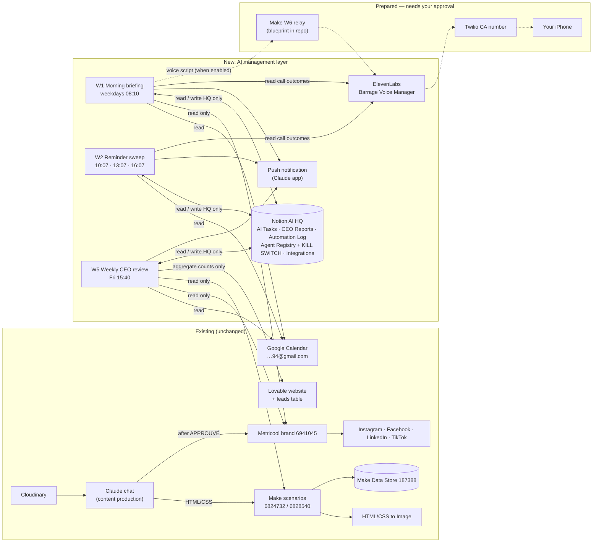

# Architecture — Barrage AI Manager

Design rule: **smallest reliable architecture**. One "brain" (Claude scheduled runs) + Notion as the shared state + existing tools untouched. No new servers, no new paid platform.

## Why not Make for the manager?
| Need | Make (current free plan) | Claude scheduled tasks |
|---|---|---|
| Scheduled runs | 2 active scenarios max | unlimited routines (plan usage) |
| Notion / Calendar access | no connection exists; needs new OAuth | connectors already authorized |
| Reasoning (prioritize, summarize, Lebanese script) | needs paid AI modules | native |
| Cost | 0 until limits, then paid tier | 0 extra (existing Claude subscription) |

Make stays the execution engine for **content rendering** (unchanged) and is the proposed **voice-call relay** (W6) because a Make keychain can hold the ElevenLabs API key outside GitHub and the relay hard-codes the only allowed phone number.

## Workflow mapping (your 6 workflows)
| Requested | Implemented as | State |
|---|---|---|
| W1 Morning CEO briefing | Routine W1 + CEO Reports | Built, tested manually, paused until connectors attached |
| W2 Intelligent reminder manager | Routine W2 + AI Tasks reminder fields | Built, paused |
| W3 Marketing operations monitor | Folded into W1 (daily) and W5 (weekly) | Built |
| W4 AI Manager task coordinator | AI Tasks Owner/Status + W2 escalation + Automation Log | Built |
| W5 Weekly CEO review | Routine W5 (Fri 15:40) | Built, paused |
| W6 ElevenLabs voice calling | Agent configured + Make relay blueprint | Prototype; calling needs approval |

## Voice command flow (no live tools during a call — by design)
1. W1 writes the Voice script + today/tomorrow/marketing/open tasks into CEO Reports.
2. (After approval) W6 relay passes them as `dynamic_variables` to the outbound call.
3. During the call the agent **only confirms** instructions; it cannot change anything.
4. After the call, ElevenLabs extracts structured fields (`reminder_requests`, `task_completions`, `decisions`, `callback_request`).
5. The next W1/W2 run reconciles them into Notion (creates reminders, closes the exact confirmed task, never approves anything).

Trade-off: a "Zakkirne ba3d se3ten" request is applied at the next W2 sweep (max ~3 h delay) rather than instantly. Upgrade path (roadmap R4): a Make webhook tool for instant writes once the Make plan allows a 3rd active scenario.

## Security controls
- Kill switch row checked first by every run.
- Write scope limited to 5 HQ databases; content, calendar, Metricool, Make content scenarios are read-only.
- Lovable: aggregate SQL only.
- Voice agent: talks only to Mohamad; no audio recording; 30-day transcript retention; max 8 conversations/day, concurrency 1, no burst billing.
- No secrets in GitHub; API keys go in a Make keychain.
- Every run logged in Automation Log.
